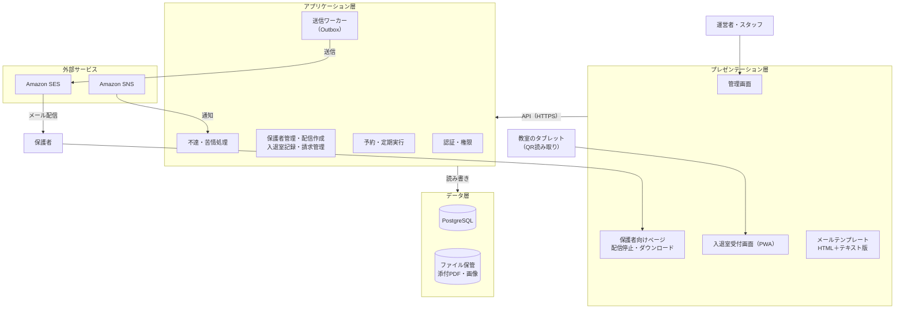
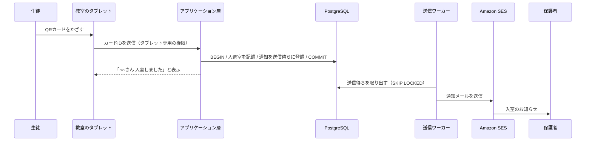

# アーキテクチャ設計書

教室向け連絡・入退室・請求管理システム

| 項目 | 内容 |
| --- | --- |
| 作成日 | 2026-10-18 |
| 作成者 | Hito |
| 状態 | ドラフト |
| 関連文書 | [業務要件定義書](requirements.md) |

## 1. 概要

本システムは、教室運営者が保護者への連絡メール、生徒の入退室通知、月謝などの請求と入金の管理を、1つの仕組みで安全に行えるようにするものである。

- 3層構成（プレゼンテーション層・アプリケーション層・データ層）とし、各層は隣の層とだけやり取りする。
- データベースはトランザクションに対応したPostgreSQLとする。
- 生徒の所在情報と金銭データを扱うため、高いセキュリティを前提に設計する。

## 2. フェーズ計画

| フェーズ | 内容 | 新しく扱うデータ | 前提条件 |
| --- | --- | --- | --- |
| 1 | メール配信（HTMLメール、添付ファイル対応） | 保護者の連絡先、配信同意、配信履歴 | SESの本番アクセス承認 |
| 2 | QRコードによる入退室記録と、保護者への通知メール | 生徒の入退室時刻 | フェーズ1の送信キューが稼働していること |
| 3 | 請求（月謝など）と入金の突き合わせ（消し込み） | 請求額、入金記録 | 本部の集金方式の確認 |

フェーズ1から、フェーズ3で必要になるセキュリティ水準を前提に作る。後からセキュリティを足すより、最初から組み込むほうが手戻りが少ないためである。

## 3. 論理アーキテクチャ（3層）



| 層 | 責務 | 主な構成要素 |
| --- | --- | --- |
| プレゼンテーション層 | 利用者との接点。入力を受け付け、結果を表示する。業務の判断はしない | 管理画面、保護者向けページ、入退室受付画面、メールテンプレート |
| アプリケーション層 | 業務ルールの実行とトランザクションの管理 | 認証・権限、保護者管理、配信作成、入退室記録、請求・消し込み、送信ワーカー、予約実行、不達・苦情処理 |
| データ層 | データの保存と取り出し | PostgreSQL、ファイル保管、送信停止リスト |

**層の間のルール**

- プレゼンテーション層はデータ層に直接アクセスせず、必ずアプリケーション層のAPIを通す。
- 外部サービス（SES・SNS）は、アプリケーション層からだけ呼び出す。
- 層を分けておくことで、画面をReactやスマホアプリに作り替えても、アプリケーション層とデータ層には手を入れずに済むようにする。

## 4. 技術選定

| 層 | 採用技術 | 選定理由 |
| --- | --- | --- |
| プレゼンテーション | Jinja2＋HTMX、CSSはTailwindまたはPico.css | 管理画面は数画面程度で、サーバー側描画のほうが作る量が少ない。HTMXで部分更新もできる |
| プレゼンテーション（メール） | MJML | メールアプリごとの表示崩れを防いだHTMLを生成できる |
| プレゼンテーション（入退室） | PWA＋ブラウザのカメラAPI | 専用アプリなしで、タブレットのブラウザからQRを読み取れる |
| アプリケーション | Python＋FastAPI | 軽量で、小規模なサーバーでも動く。Pydanticで入力を厳密に検証できる |
| アプリケーション（DBアクセス） | SQLAlchemy 2.0、Alembic | トランザクション境界をコードで明示できる。スキーマ変更を履歴として管理できる |
| データ | PostgreSQL | ACIDトランザクションに対応。`SKIP LOCKED` によりDBだけで送信キューを実装できる。DDLもトランザクションの中で取り消せる |
| インフラ | AWS（Lightsail、SES、SNS、Route 53、CloudFront）、東京リージョン | 定額で始めやすく、メール送信とDNSをAWS内にまとめられる |

**検討したが採用しなかった案**

| 案 | 見送った理由 |
| --- | --- |
| Java＋Spring Boot | トランザクション管理は最も成熟しているが、メモリ消費が大きく、この規模には重い |
| React（Next.js）などのSPA | 画面とAPIを別々に作るため作業量が約2倍になる。必要になった時点で移行する |
| MySQL | トランザクションには対応しているが、キュー用途とDDLの扱いでPostgreSQLが有利 |
| Celery＋Redis | 規模に対して構成が過剰。PostgreSQLのキューで十分 |

## 5. トランザクション設計

### 5.1 基本方針

- トランザクションの範囲はアプリケーション層で決める。SQLAlchemyの `session.begin()` のブロックを1つのトランザクションとし、正常終了でCOMMIT、例外でROLLBACKする。
- 分離レベルはPostgreSQLの既定（READ COMMITTED）とし、必要な箇所だけ行ロックを使う。
- 外部サービス（SES）の呼び出しはロールバックできないため、DBのトランザクションの中では行わない。

```python
with Session(engine) as session:
    with session.begin():          # BEGIN
        session.add(delivery)
        session.add_all(recipients)
    # 正常に抜けると COMMIT、例外が出ると ROLLBACK
```

### 5.2 メール送信（Outboxパターン）

1. 配信1件と宛先N件を、1つのトランザクションで「送信待ち」として登録する。
2. 送信ワーカー（Webアプリとは別プロセス）が、`SELECT … FOR UPDATE SKIP LOCKED` で送信待ちを少しずつ取り出す。
3. ワーカーは送信の直前に配信停止の状態を確認し、SESに送信する。
4. 結果に応じて、宛先ごとの状態を「送信済み」または「失敗」に更新する。

| 状態 | 意味 |
| --- | --- |
| pending | 送信待ち |
| sending | ワーカーが処理中 |
| sent | 送信済み |
| failed | 送信失敗（再試行の対象） |
| skipped | 配信停止・不達のため送信しなかった |

**二重送信の防止**

- `SKIP LOCKED` により、ワーカーが複数動いても同じ宛先を二重に取り出さない。
- 宛先ごとに一意のキーを持たせ、再実行しても重複して送信しない。
- 送信の速さはSESの送信上限（1秒あたりの通数）に合わせて調整する。

### 5.3 入退室（フェーズ2）

- 入退室の記録と、通知メールの送信待ち登録を、1つのトランザクションで行う。メールの送信は5.2の送信キューに任せる。
- 同じカードを短時間に連続で読み取った場合は、2回目以降を記録しない。
- 入室と退室は、直前の記録をもとに自動で切り替える。

### 5.4 請求と入金（フェーズ3）

- 請求と入金のデータは、更新・削除をしない「追記のみ」の記録とする。誤りは、取り消しの記録を追加して訂正する。
- 入金データ（銀行明細のCSVなど）を取り込み、請求と自動で突き合わせる。一致しないものだけを人が確認する。
- 消し込み（請求と入金の対応付け）は、1つのトランザクションで双方の状態を更新する。
- クレジットカード番号はシステムで扱わない。カード決済が必要になった場合は、決済代行サービスを使う。

## 6. QR入退室の設計（フェーズ2）



- QRコードの中身は、意味を持たないランダムなIDとする。氏名などの個人情報は入れない。
- カードをなくした場合は、そのIDを無効化して再発行できるようにする。
- タブレットには「読み取り結果の登録」だけができる専用の権限を割り当てる。タブレットが盗まれても、保護者情報は見られないようにする。

## 7. セキュリティ設計

### 7.1 層ごとの対策

| 層 | 対策 |
| --- | --- |
| プレゼンテーション | HTTPSのみ（HSTS）、CSRF対策、Cookieの保護（HttpOnly・Secure・SameSite）、CSPによる外部スクリプトの制限。必要に応じてCloudFrontにAWS WAFを追加 |
| アプリケーション | 管理者ログインにMFA（認証アプリ）を必須とする、パスワードはArgon2でハッシュ化、ログイン試行回数の制限、役割ごとの権限、すべての操作の監査ログ、Pydanticによる入力検証 |
| データ | DBはインターネットに公開しない（アプリケーション層からだけ接続）、DBユーザーを用途ごとに分けて最小限の権限にする、毎日のバックアップ、フェーズ3からはLightsailのマネージドデータベースに移行 |
| 運用 | SSHは自分のIPアドレスからだけ許可、OSの自動更新、AWSはIAMユーザー＋MFAで操作、SESのIAM権限は送信だけに絞る |

### 7.2 役割と権限

| 役割 | できること |
| --- | --- |
| 運営者 | すべての操作（保護者管理、配信、入退室の確認、請求・入金の管理、ユーザー管理） |
| スタッフ | 配信の作成・送信、入退室の確認。請求・入金とユーザー管理はできない |
| タブレット | QR読み取り結果の登録だけ。データの閲覧はできない |
| 保護者 | トークン付きURLから、自分の配信停止とファイルのダウンロードだけ |

### 7.3 秘密情報の管理

- DBのパスワード、SESの認証情報などはコードに書かず、AWS Systems Manager Parameter Storeで管理する。
- 公開リポジトリには、生徒・保護者のデータ、接続情報、教室固有の設定を置かない。
- 依存ライブラリの脆弱性は、GitHubのDependabotで継続的に確認する。

### 7.4 監査ログ

次の操作は、日時・操作者・対象・内容を記録し、削除できないようにする。

- ログイン（成功・失敗）
- 保護者情報の登録・変更・削除
- メールの送信
- 入退室記録の修正
- 請求・入金・消し込みの登録と取り消し

## 8. インフラ構成

| 構成要素 | サービス | 備考 |
| --- | --- | --- |
| Webサーバー・アプリ・ワーカー | Amazon Lightsail（東京） | メモリ2GB以上のプラン |
| データベース | PostgreSQL（フェーズ1・2はLightsailインスタンス内、フェーズ3からLightsailマネージドデータベース） | インターネットに公開しない |
| ファイル保管 | Lightsailオブジェクトストレージ、またはS3 | 期限付きURLでダウンロードさせる |
| CDN・HTTPS | CloudFront（Lightsailディストリビューション） | 無料のSSL証明書 |
| メール送信 | Amazon SES（東京） | DKIM・SPF・DMARC設定済み |
| 不達・苦情の通知 | Amazon SNS | アプリケーション層のエンドポイントに通知 |
| DNS | Route 53 | |
| コスト監視 | AWS Budgets | 設定済み |

## 9. 未決事項

- [ ] 本部提供のツールを独自システムに切り替えてよいか（本部確認）
- [ ] 月謝の集金を本部が代行しているか、教室が直接行っているか（フェーズ3の範囲に影響）
- [ ] 電子帳簿保存法の対象になるか
- [ ] 入退室通知を保護者全員に送るか、希望者だけにするか
- [ ] タブレットの機種と設置場所
- [ ] AWS WAFを導入するか（月額費用が増える）
