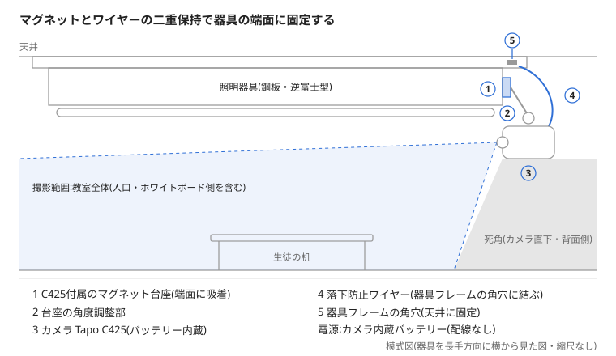

# 教室カメラ設置設計書

Oct 25, 2026 · @Hito

## 概要

教室奥の蛍光灯器具の端面に、Tapo C425を付属のマグネット台座で1台取り付け、教室全体を見下ろす。穴あけ・電気工事・配線は行わず、カメラの内蔵バッテリーで動かす。

| 項目 | 内容 |
| --- | --- |
| 目的 | 教室内の見守り(詳細は未確定事項を参照) |
| 設置場所 | 教室奥の蛍光灯器具の端面(銘板のある平らな面) |
| 撮影方向 | 教室全体を見下ろす(入口・ホワイトボード側を含む) |
| 固定方式 | Tapo C425付属のマグネット台座+落下防止ワイヤー |
| 電源 | 内蔵バッテリー(配線なし)。定期的に取り外して充電 |
| 台数 | 1台(死角が残れば窓側に2台目を検討) |

## 設置条件

取付先の器具は鋼板製でマグネットが付くが、天井直付けで発熱があり、真下に生徒の机がある。

| 項目 | 現状 | 設計への影響 |
| --- | --- | --- |
| 照明器具 | 岩崎電気 FSS4-401GL1(逆富士型、FL40×1灯、100V、46W) | 本体は鋼板。端面(銘板のある平らな面)にマグネットを付ける |
| 器具の表面 | 端部に錆・塗装の浮きあり | 錆のない面を選び、脱脂してから付ける |
| 器具の温度 | 安定器で温まる | カメラ本体(バッテリー)を器具から離し、マグネット部だけ接触させる |
| 天井 | 石膏ボード系の吹付け仕上げ | 穴あけ・粘着は使わない |
| 器具の下 | 生徒の机と椅子 | 落下防止ワイヤーを必須とする |
| 器具の今後 | 蛍光灯は2027年末で製造・輸入終了 | LED器具への交換時にカメラを付け直す |

## 構成と部品表

カメラは Tapo C425(TP-Link)とする。付属のマグネット台座を器具の端面に直接吸着させ、別系統で落下防止ワイヤーを器具フレームに結ぶ。

| No. | 部品 | 仕様 | 数量 | 用途 | URL |
| --- | --- | --- | --- | --- | --- |
| 1 | カメラ Tapo C425 | 2K(2560×1440)、対角150°・水平134°、内蔵10000mAh、動作温度−20〜45℃、マグネット台座・充電用アダプタ付属 | 1 | 撮影 | [製品ページ](https://www.tapo.com/jp/product/smart-camera/tapo-c425/) · [Amazon](https://www.amazon.co.jp/s?k=Tapo+C425) |
| 2 | microSDカード | SDHC/SDXC、最大512GB(C425の対応範囲) | 1 | 録画の保存 | [Amazon](https://www.amazon.co.jp/s?k=microSDXC+128GB) |
| 3 | 落下防止ワイヤー | 被覆付きステンレスワイヤー+カラビナ(フレームの角穴に通る太さ) | 1 | 落下防止 | [Amazon](https://www.amazon.co.jp/s?k=落下防止ワイヤー+カラビナ) · [モノタロウ](https://www.monotaro.com/s/?q=落下防止ワイヤー) |
| 4 | 保護シート(任意) | 基本は使わない(吸着力を優先)。台座が滑る・塗装を削る場合のみ、薄手のフェルトまたはゴム(1mm以下) | 必要時のみ | 器具の塗装保護・滑り止め | [Amazon](https://www.amazon.co.jp/s?k=フェルトシート+粘着+薄手) |

### 購入候補とURL

Tapo C425を採用した。バッテリー内蔵機の中で画角が最も広く、マグネット台座が付属するので、別売のマグネットベースと自由雲台は不要。魚眼(180°)の機種はAC給電・PoEのみのため見送った。

| 候補 | 画角 | 電源 | 判断 |
| --- | --- | --- | --- |
| [Tapo C425](https://www.tapo.com/jp/product/smart-camera/tapo-c425/) | 対角150° | 内蔵バッテリー | 採用 |
| [Reolink FE-W(魚眼)](https://bestbuy.ca/en-ca/product/reolink-6mp-wifi-360-panoramic-fisheye-camera-built-in-siren-two-way-audio-fe-w/17985610) | 180° | ACアダプタ | 配線が必要なため見送り |

- Tapo C425の動作温度は−20〜45℃。器具の熱でこれを超えないよう、カメラ本体を器具から離す。
- 電池持ちの300日は動体検知での録画と視聴を含む値で、録画が多い教室ではもっと短くなる。
- 落下防止ワイヤーは、カメラ本体のどこに結べるかを現物で確認する。

録画の保存先は、microSDカード、Tapo Care(有料クラウド)、対応ハブのストレージの3つ([TP-Link FAQ](https://www.tp-link.com/my/support/faq/3610))。Googleドライブへの自動保存はなく、残したい映像だけアプリからスマホに保存し、手動でアップロードする。

| 保存先 | 費用 | 特徴 |
| --- | --- | --- |
| microSDカード | カード代のみ(一度きり) | カメラ本体に保存。カメラごと盗まれると映像も失う |
| Tapo Care(1台) | 月額400円/年額4,000円 | SDカード不要。保存期間はプランで決まり、期限切れの映像は取り出せない |
| Tapo Care プレミアム(最大10台) | 月額1,380円/年額13,600円 | 2台目を追加する場合 |
| 対応ハブのストレージ | ハブ本体の購入費 | C425が対応するかは型番とハードウェアバージョンで確認 |

Tapo Careの料金は日本国内向け、iOSアプリでの価格([TP-Link](https://www.tp-link.com))。iOS以外の価格は未確認。

出典:[Tapo C425 製品ページ](https://www.tapo.com/jp/product/smart-camera/tapo-c425/v1.20/) · [Tapo C425 仕様](https://www.tapo.com/hu/product/tapo-c425-security-camera/specs/) · [Impress Watch(画角・価格)](https://internet.watch.impress.co.jp/docs/news/1570710.html) · [Reolink FE-W](https://bestbuy.ca/en-ca/product/reolink-6mp-wifi-360-panoramic-fisheye-camera-built-in-siren-two-way-audio-fe-w/17985610)

## 取付図

マグネット(1)が外れても、器具フレームに結んだワイヤー(4)でカメラが机まで落ちない。電源はカメラの内蔵バッテリーで、配線はない。

## 電源・充電計画

電源はカメラの内蔵バッテリーとし、配線はしない。その代わり、定期的に取り外して充電する。

1. 録画は常時ではなく動体検知にする。常時録画は電池の減りが速く、対応しない機種も多い。
2. アプリでバッテリー残量の通知をオンにする。
3. 残量が少なくなったら、生徒のいない時間に取り外して充電する。
4. 充電の担当者と、残量を確認する曜日を決めておく。

電池の持ちは機種と録画設定で大きく変わるため、設置後2週間の残量の減り方を見て充電周期を決める。

## 安全対策

真下に生徒が座るため、マグネットが外れてもカメラが落ちない二重の保持を条件とする。

| リスク | 対策 |
| --- | --- |
| マグネットのずれ・脱落 | 落下防止ワイヤーを、天井に固定された器具フレーム(鋼製の枠)の角穴に通して結ぶ。穴の縁で擦れないよう被覆付きワイヤーを使う。ワイヤーの長さは、外れても机に届かない短さにする |
| 器具の熱とバッテリー | リチウム電池は高温で劣化・膨張しやすい。カメラ本体を器具から離し、触れるのはマグネット部だけにする。夏場に器具とカメラの温度を確認する |
| 充電時の取り外し | 脚立を使うので生徒のいない時間に行う。再設置のたびにワイヤーが結ばれていることを確認する |
| 器具の塗装傷・錆の進行 | 基本は保護シートなしで吸着力を優先する。台座が滑る・塗装を削る場合のみ、1mm以下の薄いシートを敷く |
| 感電 | 器具の内部配線に触れない。ランプ交換・器具清掃の前はカメラを外す |

## 運用ルール

子どもが映る教室なので、設置前に目的と扱いを決め、保護者に知らせてから運用を始める。

| 項目 | 決めること | 推奨 |
| --- | --- | --- |
| 保護者への告知 | 目的・撮影範囲・保存期間・閲覧者 | 教室内の掲示と、お知らせの配布 |
| 音声 | 録音するか | 録音しない(マイクをオフに設定) |
| 保存期間 | 録画を何日残すか | 目的に必要な最短期間(例:1〜2週間)で自動上書き |
| 閲覧権限 | 誰が見られるか | 教室の責任者のみ。アカウントは2段階認証を有効にする |
| 撮影範囲 | 映さない場所 | トイレ・更衣の場所・窓の外が映らない向きにする |
| フランチャイズ本部 | 設置のルール・推奨の有無 | 設置前に確認する |
| 物件 | 貸主の承認の要否 | 穴あけをしないので通常は不要。契約書で念のため確認 |

## 施工手順とチェックリスト

施工は生徒のいない時間に、脚立と補助者1名で行う。

1. 照明を消し、器具が冷えていることを確認する。
2. 手持ちの磁石で、取付面にマグネットが付くことを確認する。
3. 取付面の錆・汚れを拭き取り、脱脂する。
4. Tapo C425を充電し、microSDカードを入れてアプリで初期設定を済ませ、地上で動作と画角を確認する。
5. 落下防止ワイヤーを先に器具フレームの角穴に通して結び、カメラ側に留める。フレーム内部の配線や端子には触れない。
6. C425のマグネット台座を取付面に付けてカメラを載せ、カメラの向きを教室全体が入るように合わせる。
7. カメラの電源を入れ、アプリでバッテリー残量の通知をオンにする。
8. 照明を点け、白飛び・逆光・死角をアプリの映像で確認し、角度を微調整する。

- [ ] マグネットを手で横に押してもずれない
- [ ] 落下防止ワイヤーが器具本体に結ばれ、外れても机に届かない
- [ ] 充電の担当者と、残量を確認する曜日を決めた
- [ ] 映してはいけない場所が画面に入っていない
- [ ] 音声録音がオフになっている
- [ ] 録画の保存期間と閲覧アカウントを設定した
- [ ] 保護者への告知を掲示・配布した

## 未確定事項

- [ ] 目的:防犯(不在時)、見守り、指導の振り返り、遠隔での様子確認のどれか
- [ ] C425本体のどこに落下防止ワイヤーを結ぶか(現物で確認)
- [ ] 充電の周期(機種の電池持ちと録画設定で決まる)
- [ ] 1台で教室全体が収まるか(カメラ直下と背面側の死角)、2台目が要るか
- [ ] フランチャイズ本部の設置ルール
- [ ] 器具をLEDに交換する予定の有無
